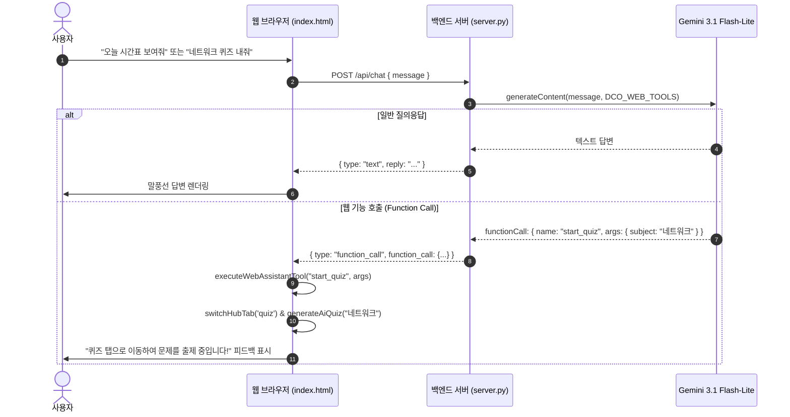

# DCO Dashboard 프로젝트 개발 및 아키텍처 가이드 (PROJECT_GUIDE.md)

> **문서 목적**: 본 가이드는 DCO(Data Center Operations) 교육 대시보드 프로젝트의 실제 코드베이스 및 데이터베이스 구조를 기반으로 작성되었습니다. 향후 새로운 CLI 세션이나 다른 개발자가 투입되더라도 프로젝트의 아키텍처, 데이터 저장 방식, AI 연동 메커니즘, 그리고 향후 개발 로드맵을 일관성 있게 파악하고 안전하게 기능을 확장할 수 있도록 돕는 표준 개발 지침서입니다.

---

## 1. 프로젝트 목적 및 전체 구조

### 1-1. 프로젝트 목적
* **DCO(AWS Data Center Operations) 채용 연계 교육 과정**을 수강하는 엔지니어들을 위한 올인원 학습 관리 및 실무 트레이닝 웹 대시보드입니다.
* 복잡한 교육 시간표(1~6주차 종합 일정)를 실시간 날짜 기반으로 자동 추적하여 **오늘/내일 일정** 및 **전체 교육 진도율(%)**을 직관적으로 시각화합니다.
* 현장 실무에 필요한 **핵심 지식 카드, 실무 퀴즈, 개인별 학습 메모**를 제공하고, Google Gemini API 기반의 **대화형 AI 비서 및 Function Calling**을 통해 자연어로 웹사이트 기능을 직접 제어할 수 있는 지능형 학습 환경을 제공합니다.

### 1-2. 배포 및 런타임 환경
* **프론트엔드**: 단일 페이지 웹 애플리케이션 (`index.html`) - Vanilla JavaScript, CSS3, HTML5
* **백엔드**: 경량 Python HTTP API 서버 (`server.py`) - Python 표준 라이브러리 `http.server`, `urllib` 기반
* **클라우드 배포**: **Render** (`render.yaml` - Python Web Service, Free 플랜)
* **데이터베이스**: **Supabase PostgreSQL** (PostgREST RESTful API 연동)
* **AI 엔진**: **Google Gemini API** (`gemini-3.1-flash-lite`)

---

## 2. 프론트엔드와 백엔드 구성

### 2-1. 프론트엔드 구성 (`index.html`)
* **스타일 시스템 (CSS)**:
  * CSS Custom Properties(변수) 기반의 Glassmorphism 다크 테마 및 라이트 테마 완벽 지원 (`body.light`).
  * 2열 반응형 그리드 (`.main-wide-grid`):
    * **좌측 메인 (`.main-wide-left`)**: 5:5 2열 분할(`dashboard-row-split`)로 **시간표(오늘/내일)**와 **학습 진행도(진도율 바 + 과목별 이수 현황)** 배치.
    * **우측 트레이닝 허브 (`.main-wide-right`)**: 탭 바(`.hub-tab-bar`)를 통해 **4개 주요 기능 패널** 전환.
* **화면 레이아웃 상태 관리**:
  * `switchHubTab(tabName)`: `card`, `quiz`, `memo`, `arch` 간 전환 처리.
  * `full-arch-mode`: 프로젝트 아키텍처 탭 활성화 시 좌측을 숨기고 와이드(1열)로 자동 확장.
  * `toggleScheduleView()`: 오늘/내일 일정 뷰 ↔ 1~6주차 주차별 종합 시간표 뷰 애니메이션 전환.
* **클라이언트 데이터 캐싱 및 동기화**:
  * `memos`: 사용자 메모 배열 (`{ id, text, date, subject }`)
  * `cards`: 핵심 지식 카드 목록 (기본 공식 카드 + 사용자 생성 AI 카드)
  * `quizzes`: 실무 퀴즈 목록 (기본 퀴즈 + 사용자 생성 AI 퀴즈)
  * 세션 토큰: `localStorage.getItem('dco_auth_token')` 기반 인증 상태 관리.

### 2-2. 백엔드 구성 (`server.py`)
* 외부 무거운 프레임워크(Django/FastAPI) 없이 **Python 표준 라이브러리(`http.server.SimpleHTTPRequestHandler`)**로 가볍고 안전하게 구동됩니다.
* **주요 엔드포인트 목록**:
  * `POST /api/auth/login`: PBKDF2-SHA256 암호 검증, 32바이트 보안 세션 토큰 발급 및 일일 사용량 조회.
  * `POST /api/auth/register`: 회원가입 (신규 유저는 기본 `role="user"`로 가입).
  * `POST /api/auth/logout`: 세션 토큰 무효화.
  * `GET /api/auth/me`: 현재 세션 유저 정보 및 일일 잔여 API 횟수(기본 5회, 관리자 무제한) 반환.
  * `GET /api/user/data`: 로그인 유저의 격리된 저장 데이터(메모, 카드, 퀴즈, 대화 기록) 통합 조회.
  * `POST /api/user/save-data`: 유저별 메모/카드/퀴즈/대화 동기화 저장 (Supabase 테이블 배치 갱신).
  * `POST /api/chat`: Gemini 대화 처리, Function Calling 도구 호출(`DCO_WEB_TOOLS`) 및 일일 사용량 차감.
  * `POST /api/generate-card`: DCO 실무 지식 카드 AI JSON 생성 및 유저 저장소 등록.
  * `POST /api/generate-quiz`: 4지선다형 DCO 면접/실무 기술 퀴즈 AI JSON 생성 및 유저 저장소 등록.
  * `GET /api/git-patches`: GitHub API 프록시 (최신 커밋 15건 파싱, `GITHUB_TOKEN` 환경변수 은닉).
  * `POST /api/log-action`: 사용자 행동 로그 비동기 수집.
  * `GET /api/admin/usage`: 관리자(`role="admin"`) 전용 전체 회원 사용량 및 활동 로그 조회.

---

## 3. Supabase 데이터베이스 구조와 데이터 저장 방식

Supabase의 PostgreSQL 인스턴스에 직접 TCP를 연결하지 않고, PostgREST REST API 엔드포인트(`SUPABASE_URL/rest/v1/...`)를 `SUPABASE_SERVICE_ROLE_KEY`로 호출하여 빠르고 안정적으로 통신합니다.

### 3-1. 테이블 명세

| 테이블명 | 주요 컬럼 구조 | 설명 및 역할 |
| :--- | :--- | :--- |
| **`user_accounts`** | `username`(PK), `name`, `password_hash`, `role`, `session_token`, `last_login_at`, `created_at` | 회원 계정 정보 (`role`: `'user'` 또는 `'admin'`) |
| **`user_memos`** | `id`(PK, bigint), `username`, `text`, `date`, `subject`, `created_at` | 사용자별 학습 메모 및 리마인더 저장소 |
| **`user_quizzes`** | `id`(PK, text), `username`, `data`(jsonb), `created_at` | 유저가 AI로 생성하거나 저장한 맞춤형 퀴즈 |
| **`user_knowledge_cards`** | `id`(PK, text), `username`, `data`(jsonb), `created_at` | 유저가 생성한 맞춤 실무 지식 카드 |
| **`user_chat_logs`** | `id`(PK, text), `username`, `question`, `reply`, `timestamp` | AI 챗봇과의 대화 내역 (개인별 격리) |
| **`api_daily_usage`** | `username`, `usage_date`, `call_count`, `last_called_at` | 일일 AI API 호출량 추적 (일반 유저 5회 한도) |
| **`user_activity_logs`** | `id`, `username`, `name`, `role`, `action`, `details`, `is_api`, `extra`(jsonb), `timestamp` | 관리자 분석용 실시간 사용자 활동 감사 로그 |

### 3-2. 데이터 저장 및 동기화 원칙
1. **사용자별 데이터 격리**: 모든 개인 데이터 조회/저장 시 세션 토큰에서 복호화된 `username` 조건을 필수 적용(`username=eq.{user}`).
2. **원자적 동기화 방식**: `save-data` 엔드포인트는 사용자 편의를 위해 기존 해당 사용자의 행을 정리 후 새 목록을 일괄 삽입(POST)하여 데이터 불일치를 방지합니다.
3. **하위 호환성 유지**: 기존 메모의 `subject` 컬럼 값이 없거나 레거시 명칭(`'학습 메모'`, `'자율 학습/일과 외'`)인 경우 데이터베이스 원본을 변경하지 않고 클라이언트에서 정규화(`normalizeMemoSubject`)하여 `'개인 학습'`으로 표시합니다.

---

## 4. 현재 구현되어 있는 기능과 각 기능의 역할

> ⚠️ **주의**: 아래 목록은 현재 실제 코드에 구현되어 정상 작동 중인 기능만을 기술하였습니다.

### 4-1. 대시보드 3개 영역 기본 배치
1. **[왼쪽] 시간표 영역**:
   * **오늘 & 다음 수업일 2분할 카드**: 실시간 날짜를 기반으로 오늘 수업(오전/오후/야간)과 다음 수업일의 과목 및 강의실을 자동 표시합니다.
   * **1~6주차 주차별 종합 시간표 펼치기**: [전체 시간표 보기] 버튼 클릭 시 슬라이드 전환되며 6주간의 전체 시간표 매트릭스를 제공합니다. 시간표의 과목을 클릭하면 공식 교재 정보 팝업이 노출됩니다.
2. **[가운데] 학습 진행도 영역**:
   * **전체 교육 총 진도율 카드**: 전체 240시간 중 현재 날짜까지 진행된 수업 시수(`completedHours`)를 자동 누적 계산하여 진도율 퍼센트(%)와 프로그레스 바를 표시합니다.
   * **과목별 이수 & 잔여 현황판**: 12개 공식 교과목 각각의 총 배정 시간, 이수 시간, 잔여 시간을 그리드 카드로 실시간 계산해 보여줍니다.
3. **[오른쪽] 실무 트레이닝 허브 4개 탭**:
   * **탭 1: 핵심 지식 (`#tabBtnCard`)**: DCO 실무 엔지니어링 팁 캐러셀(6장 기본 제공) 및 [✨ AI생성] 버튼을 통한 신규 지식 카드 즉시 발행.
   * **탭 2: 실무 퀴즈 (`#tabBtnQuiz`)**: 4지선다형 기술 퀴즈 풀이, 즉각적인 오답/정답 해설, 점수 집계(100점 만점), [✨ AI출제] 버튼을 통한 무제한 퀴즈 생성.
   * **탭 3: 메모/리마인더 (`#tabBtnMemo`)**:
     * **과목별 탭 필터링**: 전체, 시간표 등록 과목별, 개인 학습 탭으로 메모를 분류 조회.
     * **과목 자동 선택**: 작성 시 현재 시간표상 수업 중인 과목을 자동 선택(수동 변경 가능).
     * **리마인더 알림**: `[!] 중요 리마인더` 체크 시 상단 배너 강조 표시.
   * **탭 4: 프로젝트 아키텍처 (`#tabBtnArch`)**:
     * 시스템 아키텍처 다이어그램(클라이언트-서버-Supabase-Gemini) 및 시퀀스 다이어그램 (Mermaid.js 실시간 렌더링).
     * GitHub API 연동 최신 커밋 패치 이력 실시간 표시 (5분 간격 자동 갱신).

---

## 5. Gemini AI 챗봇 및 Function Calling 연동 방식

### 5-1. AI 챗봇 개요
* 우측 하단 플로팅 버튼(FAB)을 클릭하여 대화창을 호출할 수 있습니다.
* 모델: `gemini-3.1-flash-lite` (안정적이고 빠른 속도와 경제적인 토큰 소비).
* DCO 수석 엔지니어 페르소나가 부여되어 데이터센터 실무 지식을 전문적으로 답변합니다.

### 5-2. Function Calling (도구 실행) 연동 구조
단순 대화에 그치지 않고, 사용자의 자연어 요청을 분석하여 브라우저의 UI 함수를 직접 실행합니다.



### 5-3. 현재 지원되는 12가지 어시스턴트 도구
1. `show_today_schedule`: 오늘의 시간표 및 강의실 안내
2. `show_tomorrow_schedule`: 내일/다음 수업일 시간표 표시
3. `show_full_schedule`: 1~6주차 전체 종합 시간표 펼치기
4. `show_subject_book_info`: 특정 과목의 공식 교재 및 저자 팝업 호출
5. `create_user_memo`: 자연어로 새 메모/리마인더 자동 작성 및 저장
6. `list_user_memos`: 현재 작성된 메모 목록 요약 확인
7. `request_delete_memo`: 메모 삭제 요청 (사용자 Confirm 확인 후 삭제)
8. `start_quiz`: 실무 퀴즈 탭 이동 및 새 AI 문제 출제
9. `show_knowledge_card`: 핵심 지식 카드 탭 이동 및 새 지식 카드 발행
10. `show_progress_status`: 전체 교육 총 진도율 및 잔여 시간 카드 안내
11. `switch_hub_tab`: 4개 허브 탭(`card`, `quiz`, `memo`, `arch`) 간 자유 전환
12. `toggle_dashboard_theme`: 다크 모드 ↔ 라이트 모드 전환

---

## 6. 코드 수정 시 지켜야 할 원칙과 기존 기능 보호 사항

향후 본 프로젝트를 수정하거나 새로운 기능을 추가할 때는 아래 5가지 원칙을 엄격히 준수해야 합니다.

1. **기존 UI 레이아웃 및 3개 영역 배치 보존 (절대 원칙)**:
   * **[왼쪽 시간표] - [가운데 학습진도] - [오른쪽 기능탭]**의 기존 대시보드 레이아웃은 당분간 변경하지 않습니다.
   * 새로운 기능이나 페이지를 위해 메인 화면 그리드를 임의로 허물거나 재배치하지 마십시오.
2. **불필요한 데이터베이스 스키마 변경 금지**:
   * 기존 Supabase 테이블 구조(`user_memos`, `user_quizzes`, `user_knowledge_cards`, `api_daily_usage`)를 최대한 재사용합니다.
   * 기능 추가를 이유로 승인 없이 새로운 DB 테이블을 생성하거나 컬럼 타입을 바꾸지 마십시오.
3. **단일 로직 원칙 (중복 구현 금지)**:
   * UI 버튼으로 실행되는 로직과 챗봇 Function Calling으로 실행되는 로직은 반드시 **동일한 JavaScript 컨트롤러 함수**를 공유해야 합니다. (별도 API나 중복 JS 함수 생성 금지)
4. **기존 데이터 및 식별자(ID) 호환성 보장**:
   * DOM 요소의 기존 ID(`schedCardTitle`, `todayScheduleList`, `overallProgPercent`, `subjectHoursGrid`, `tabBtn*`, `hubPane*` 등)를 임의로 변경하거나 삭제하면 기존 스크립트가 중단되므로 보존해야 합니다.
5. **안전한 API 일일 사용량 관리**:
   * 모든 AI 생성 기능은 백엔드의 `check_and_increment_daily_usage(username)`를 거쳐 일반 유저의 무분별한 토큰 소모(1일 5회 초과)를 차단해야 합니다.

---

## 7. 향후 개발할 AI 학습 기능 6가지와 진행 순서 (개발 로드맵)

새로운 학습 통합 공간인 **「AI 학습실」**을 구축할 때 구현할 6가지 기능의 확정 순서입니다. **반드시 아래 순서대로 단계별 검증을 거쳐 개발**해야 합니다.

```
┌────────────────────────────────────────────────────────────────────────┐
│                      AI 학습실 6단계 개발 로드맵                       │
├────────────────────────────────────────────────────────────────────────┤
│  [1단계] 메모 기반 퀴즈 생성 (Memo-based Quiz Generation)              │
│          → 사용자가 작성한 메모 내용을 바탕으로 실무 4지선다 퀴즈 출제    │
│  [2단계] 메모 요약 및 핵심 개념 추출 (Memo Summary & Keywords)          │
│          → 방대한 메모를 3줄 요약하고 핵심 기술 태그 및 개념 추출       │
│  [3단계] 메모 기반 학습 카드 생성 (Memo-to-Knowledge Card)              │
│          → 유용한 필기 메모를 규격화된 [핵심 지식 카드]로 자동 변환 발행│
│  [4단계] 과목별 학습 기록 분석 (Subject Study Activity Analytics)      │
│          → 과목별 메모 작성 빈도, 학습 편중도, 취약 분야 시각화 리포트 │
│  [5단계] 과거 메모와 최근 메모 비교 (Past vs Recent Comparative Study)  │
│          → 초기 메모 대비 최근 메모의 개념 심화도 및 학습 성장 추적     │
│  [6단계] 개인 맞춤 복습 계획 (Personalized Spaced-Repetition Plan)     │
│          → 망각곡선 주기와 작성일을 분석하여 내일 복습할 메모 추천 등록 │
└────────────────────────────────────────────────────────────────────────┘
```

### 각 단계별 구현 세부 지침
* **1단계 (메모 기반 퀴즈)**:
  * 사용자가 선택한 과목이나 특정 메모 텍스트를 `/api/generate-quiz`의 프롬프트 컨텍스트로 전달.
  * 출제된 퀴즈는 기존 `user_quizzes` 테이블에 동일하게 저장되고 [실무 퀴즈] 탭과 즉시 연동.
* **2단계 (메모 요약/핵심 개념)**:
  * 특정 주차/과목의 메모들을 취합하여 Gemini에 핵심 3줄 불릿포인트 및 기술 키워드 JSON 추출 요청.
* **3단계 (메모 기반 지식 카드)**:
  * 메모 내용을 DCO 핵심 지식 카드의 규격(`{badge, title, desc, items}`)으로 변환하여 `user_knowledge_cards`에 저장.
* **4단계 (과목별 학습 기록 분석)**:
  * 사용자의 `user_memos` 내 `subject` 및 날짜 분포를 클라이언트에서 1차 집계 후, AI가 부족한 과목과 집중된 과목에 대한 학습 조언 코멘트 제공.
* **5단계 (과목별 과거/최근 비교)**:
  * 1~2주차 메모와 3주차 이후 메모의 기술 키워드 밀도를 비교하여 실력 향상도 분석 리포트 출력.
* **6단계 (맞춤 복습 계획)**:
  * 작성된 지 3일/7일이 경과한 메모를 AI가 선별하여 "오늘 꼭 복습해야 할 메모"로 추천하고, 버튼 클릭 시 기존 메모의 중요 리마인더로 등록.

---

## 8. 빠른 참조 가이드 (Cheatsheet)

* **로컬 서버 시작**: `./start_server.sh` 또는 `python server.py` (기본 포트: `8080`)
* **환경 변수 파일 (`.env`)**:
  * `GEMINI_API_KEY`: Google AI Studio 발급 키
  * `SUPABASE_URL`: Supabase 프로젝트 URL
  * `SUPABASE_SERVICE_ROLE_KEY`: Supabase Service Role Secret Key (RLS 우회 백엔드용)
  * `GITHUB_TOKEN`: (선택) GitHub Commit API 호출 한도 확장용 토큰
* **관리자 기본 계정**: ID `admin`, PW `admin123` (개발/시연용 빠른 로그인 버튼 지원)
